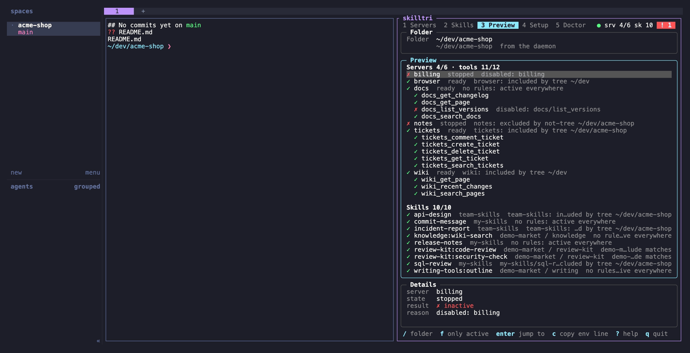
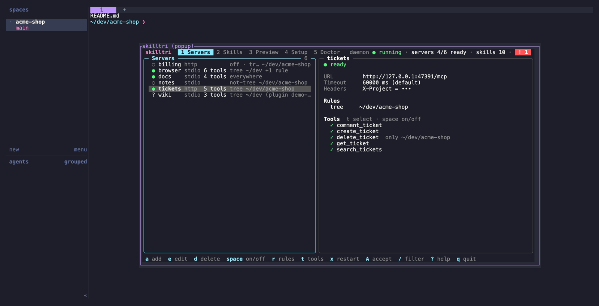

# herdr-skilltri

Run [skilltri](https://github.com/baeroe/skilltri) in a [herdr](https://herdr.dev) split pane, its own tab or a popup. skilltri is an MCP gateway and agent skill manager with per-folder rules: you add MCP servers and skill sources once, decide in which folders each one is active, and every agent harness gets exactly that set. herdr-skilltri works the same way as [herdr-lazydocker](https://github.com/sudoeren/herdr-lazydocker), [herdr-lazy1mcp](https://github.com/baeroe/herdr-lazy1mcp) and [herdr-tussh](https://github.com/baeroe/herdr-tussh).



*`open-skilltri`: skilltri in a split next to the shell you were working in. The Preview tab starts in that shell's folder.*

| Action | Does |
|---|---|
| `open-skilltri` | Toggles skilltri in a split to the right: opens it, focuses it, or closes it when it is focused |
| `open-skilltri-tab` | Toggles skilltri in its own tab: opens it, switches to its tab, focuses it, or closes it when it is focused |
| `open-skilltri-popup` | Opens skilltri in a popup over the current tab. It closes when you quit skilltri (`q`). |



*`open-skilltri-popup`: a quick look or a quick change, then `q` and you are back where you were.*

The skilltri pane is found by its label (`skilltri`). If `jq` is missing or `herdr pane list` fails, the split and tab actions simply open a new skilltri pane.

herdr starts plugin panes in the plugin's own folder. skilltri's Preview tab shows what a session in its working directory gets, so the plugin first changes to the folder of the pane that was focused when you ran the action (`focused_pane_cwd` from herdr's plugin context). To pin a folder, set `SKILLTRI_PANE_CWD`.

The plugin starts `skilltri` from `PATH`, falling back to `/opt/homebrew/bin`, `/usr/local/bin` and `~/.local/bin`. The herdr server often runs with a shorter `PATH` than your interactive shell. To use a different binary, set `SKILLTRI_PATH`.

The servers, skills, rules and the daemon all belong to skilltri. The plugin only opens its TUI.

## Requirements

| Tool | Why |
|---|---|
| `skilltri` | the TUI and gateway (`brew install baeroe/tap/skilltri`) |
| `jq` | toggle logic (without it, every invocation opens a new pane) |
| herdr 0.9.3+ | |

## Install

```sh
herdr plugin install baeroe/herdr-skilltri
```

Add key bindings to `~/.config/herdr/config.toml`:

```toml
[[keys.command]]
key = "alt+m"
type = "plugin_action"
command = "herdr-skilltri.open-skilltri"
description = "skilltri"

# optional: skilltri as a popup
[[keys.command]]
key = "alt+shift+m"
type = "plugin_action"
command = "herdr-skilltri.open-skilltri-popup"
description = "skilltri popup"

# optional: skilltri in its own tab
# [[keys.command]]
# key = "…"
# type = "plugin_action"
# command = "herdr-skilltri.open-skilltri-tab"
# description = "skilltri tab"
```

Then run `herdr server reload-config`.

## Tests

```sh
bash tests/run-tests.sh        # toggle decisions, launcher, working directory and popup action against a fake herdr; no herdr needed (runs in CI)
shellcheck scripts/*.sh tests/*.sh
```

## Screenshots

The images in `docs/screenshots/` are rendered from the [VHS](https://github.com/charmbracelet/vhs) tapes in `docs/tapes/` with demo data only:

```sh
brew install vhs pngquant oxipng   # vhs pulls ttyd and ffmpeg
bash docs/screenshots.sh           # or: bash docs/screenshots.sh popup
```

The script needs a [skilltri](https://github.com/baeroe/skilltri) checkout next to this repo (or `SKILLTRI_REPO=…`) and reuses its demo data: `docs/demo/seed.go` fills a sandbox `HOME` with demo servers, skill sources and folder rules, and fake MCP servers stand in for real ones. A sandboxed skilltri daemon serves them; your own skilltri config, daemon and keychain are never used. The script also starts a separate herdr server with that sandbox `HOME`, with only this plugin linked, so your own herdr session is never touched. The demo config binds the actions to `ctrl+b m` and `ctrl+b p`. Everything is removed afterwards.

## Credits

The toggle logic is adapted from [herdr-lazydocker](https://github.com/sudoeren/herdr-lazydocker) (MIT) by Eren Çakar, by way of herdr-lazysql and herdr-lazy1mcp.

## License

MIT, see [LICENSE](LICENSE).
